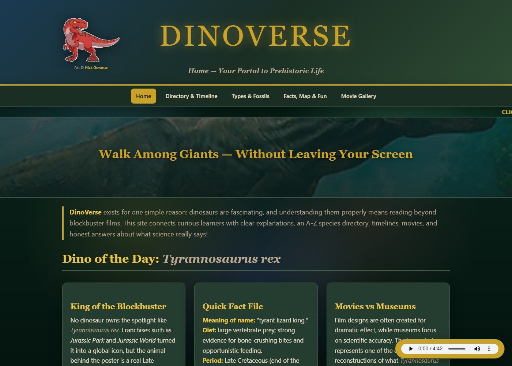
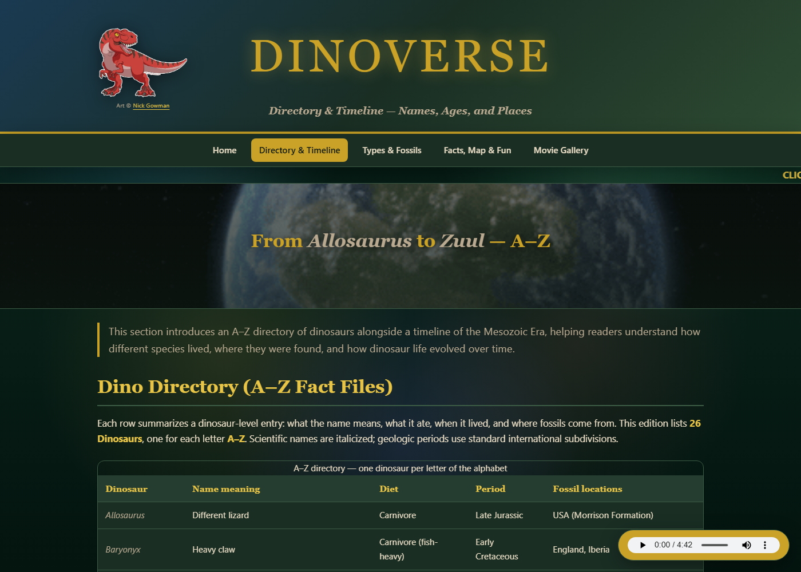
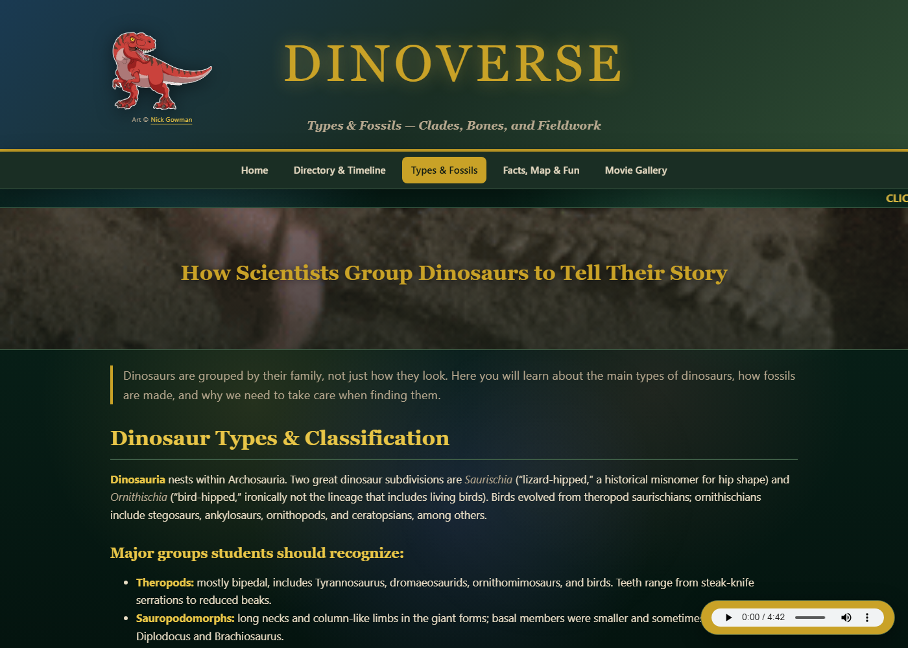
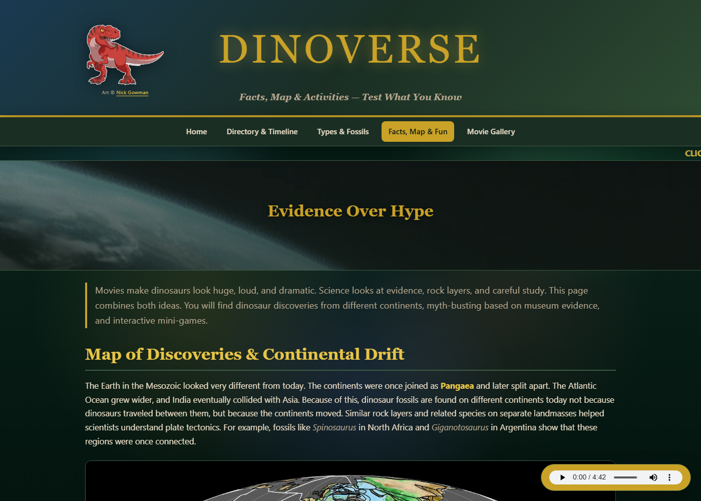
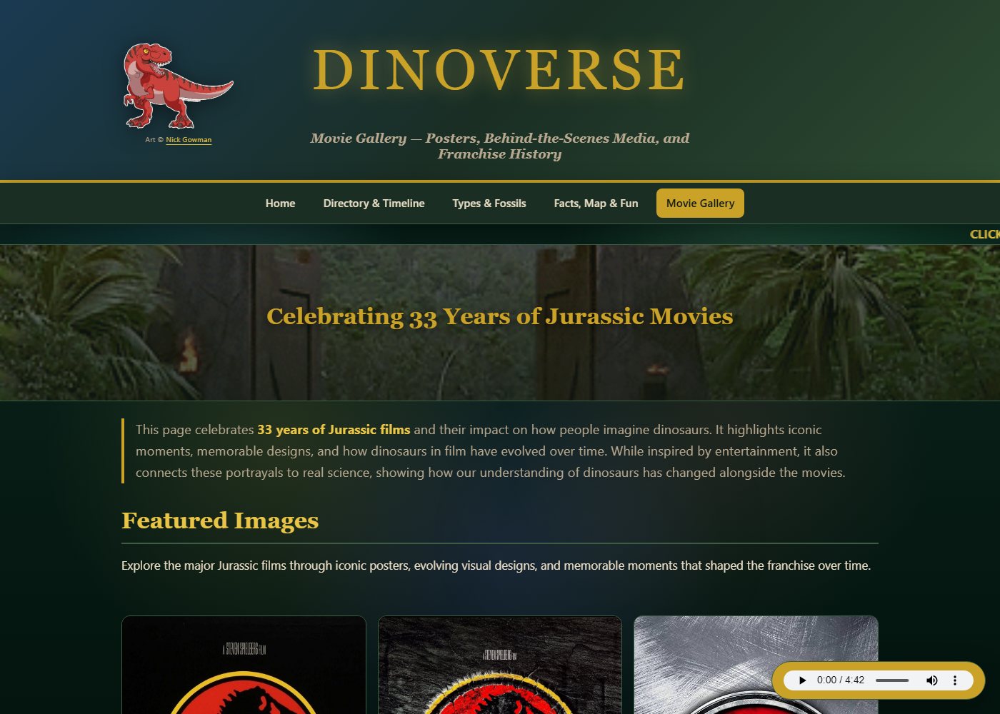

<div align="center">


# DinoVerse

**Your portal to prehistoric life. A hand-coded guide to dinosaurs, built with plain HTML and CSS.**




</div>

---

## About

DinoVerse is a multi-page educational website about dinosaurs, made as a final project for a web design course. It brings together species fact files, a Mesozoic timeline, classification and fossil science, myth-busting, a quiz, and a gallery of the *Jurassic* film franchise. All of it is written by hand in semantic HTML and one stylesheet, with no frameworks or build tools.

The goal is simple: dinosaurs are fascinating, and understanding them properly means reading beyond the blockbuster films.

## Pages

| Page | What's inside |
| --- | --- |
| [**Home**](home.html) | Dino of the Day (*T. rex*), latest paleontology news, and topic shortcuts |
| [**Directory & Timeline**](one.html) | A–Z dinosaur fact files and the Triassic → Jurassic → Cretaceous timeline |
| [**Types & Fossils**](two.html) | How dinosaurs are classified into clades, plus a fossil excavation guide |
| [**Facts, Map & Fun**](three.html) | Continental drift map, facts vs. myths, non-dinosaurs, size comparison, quiz, extinction, glossary |
| [**Movie Gallery**](four.html) | 33 years of *Jurassic* movie posters and behind-the-scenes media |
| [**404**](404.html) | A custom "This Page Went Extinct" error page |

## Screenshots

<table>
  <tr>
    <td></td>
    <td></td>
  </tr>
  <tr>
    <td align="center"><b>Directory & Timeline</b></td>
    <td align="center"><b>Types & Fossils</b></td>
  </tr>
  <tr>
    <td></td>
    <td></td>
  </tr>
  <tr>
    <td align="center"><b>Facts, Map & Fun</b></td>
    <td align="center"><b>Movie Gallery</b></td>
  </tr>
</table>

## Features

- **Semantic, accessible markup:** skip link, landmark roles, `aria-label`s, `aria-current` navigation, and descriptive alt text
- **One themed stylesheet:** a dark "Mesozoic jungle" palette defined as CSS custom properties in `webstyle.css`
- **Parallax banners** and a card-grid layout on every page
- **Responsive design** with breakpoints for tablets and phones
- **Reduced-motion support** through `prefers-reduced-motion`
- **Background music player** that loops the theme while you browse
- **Custom 404 page** that matches the rest of the site

## Run it locally

No install needed. Clone the repo and open the home page:

```bash
git clone https://github.com/GurkiratA/DinoVerse-Web-Project.git
cd DinoVerse-Web-Project
start home.html      # Windows   (macOS: open home.html · Linux: xdg-open home.html)
```

Or serve it locally:

```bash
python -m http.server 8000   # then visit http://localhost:8000
```

## Project structure

```
DinoVerse-Web-Project/
├── index.html          # Redirects to home.html (GitHub Pages entry point)
├── home.html           # Home
├── one.html            # Directory & Timeline
├── two.html            # Types & Fossils
├── three.html          # Facts, Map & Fun
├── four.html           # Movie Gallery
├── 404.html            # Custom error page
├── webstyle.css        # All site styles
├── Dinosaur Image/     # Images, GIFs and posters
├── audio/              # Background theme music
└── docs/screenshots/   # README screenshots
```

## Credits

- T. rex mascot art © [Nick Gowman](https://nickgowman.com/)
- Realistic *T. rex* image from [Science News Explores](https://www.snexplores.org/article/lets-learn-about-tyrannosaurus-rex)
- Movie posters and the *Jurassic Park* theme belong to their respective rights holders and are used here for educational purposes only
- Additional sources are listed in the **Reputable Sources** section at the bottom of every page

## Author

**Gurkirat Singh Ater** · [@GurkiratA](https://github.com/GurkiratA)
